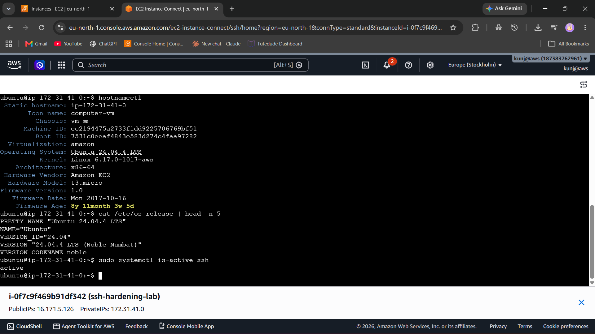
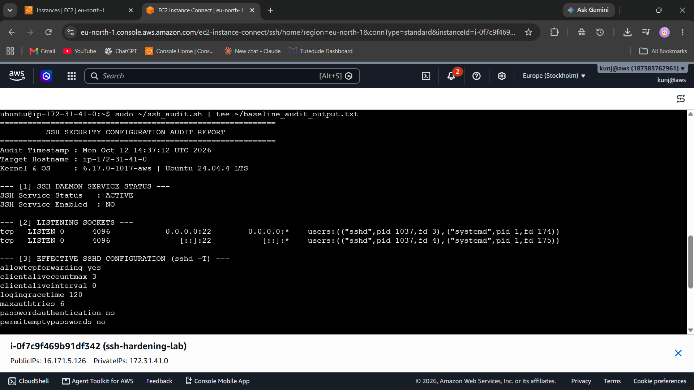
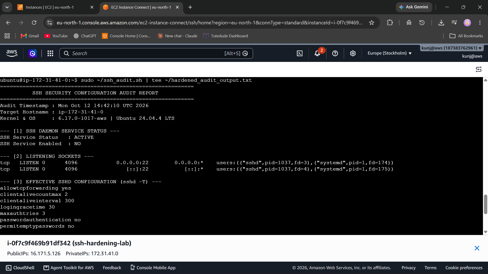
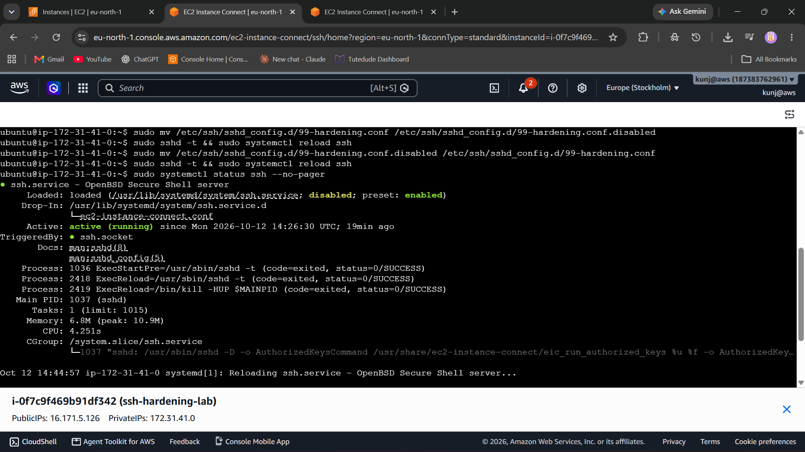

# SSH Hardening Implementation Guide & Configuration Audit

## 1. Problem / Task
> *"Create comprehensive SSH hardening guide and audit current SSH configurations."*

### Key Operational Challenges & Baseline Weaknesses
* **Unbounded Idle Sessions:** Default configurations often leave `ClientAliveInterval` at `0`, allowing inactive or abandoned SSH sessions to persist indefinitely and consume connection slots.
* **Exhaustion Attacks via Login Grace Time:** Standard setups give unauthenticated connection attempts up to 120 seconds to negotiate authentication, exposing the daemon to potential connection exhaustion.
* **Elevated Authentication Attempts:** Allowing default `MaxAuthTries` values (typically 6) leaves systems more vulnerable to brute-force and credential-stuffing attempts.
* **Broad Inbound Exposure:** Default security groups or firewalls frequently expose port 22 directly to public CIDR blocks (`0.0.0.0/0`), increasing attack surface.
* **Operational Scope:** Corporate server configurations were not provided for this task. Therefore, the audit and safe hardening demonstrations were performed on a self-managed Ubuntu 24.04 LTS EC2 instance (`t3.micro`).

---

## 2. What I Did

### Architecture & Repository Overview
We deployed an isolated, hands-on audit target and set up a structured repository:
* **Target Node:** Ubuntu 24.04.4 LTS instance on AWS EC2 (`t3.micro`).
* **Audit Automation:** Created a modular, read-only bash script (`ssh_audit.sh`) to safely extract runtime settings via `sshd -T`, verify socket status, and audit file permissions.
* **Drop-In Hardening:** Implemented configurations via drop-in file `/etc/ssh/sshd_config.d/99-hardening.conf` rather than modifying core vendor defaults directly.
* **Safe Validation & Rollback:** Tested configurations using `sshd -t` and reloaded the service with `systemctl reload ssh` while keeping an active fallback session open.

```
DEV-619-ssh-hardening/
├── README.md
├── config/
│   └── 99-hardening.conf
├── scripts/
│   └── ssh_audit.sh
└── docs/
    └── evidence/
        ├── 01_target_system_info.png
        ├── 02_baseline_audit_terminal.png
        ├── 03_hardened_audit_terminal.png
        └── 04_ssh_service_active_verification.png
```

---

### Configurations & Code Used

#### 1. Automated Read-Only Audit Script (`scripts/ssh_audit.sh`)
```bash
#!/usr/bin/env bash
set -u

echo "============================================================"
echo "          SSH SECURITY CONFIGURATION AUDIT REPORT           "
echo "============================================================"
echo "Audit Timestamp : $(date -u)"
echo "Target Hostname : $(hostname)"
echo "Kernel & OS     : $(uname -r) | $(lsb_release -ds 2>/dev/null || cat /etc/os-release | grep PRETTY_NAME | cut -d= -f2)"
echo ""

echo "--- [1] SSH DAEMON SERVICE STATUS ---"
systemctl is-active ssh >/dev/null && echo "SSH Service Status   : ACTIVE" || echo "SSH Service Status   : INACTIVE"
systemctl is-enabled ssh >/dev/null && echo "SSH Service Enabled  : YES" || echo "SSH Service Enabled  : NO"
echo ""

echo "--- [2] LISTENING SOCKETS ---"
ss -tulpn | grep -E ':(22|2222)\b' || echo "No standard SSH port listening"
echo ""

echo "--- [3] EFFECTIVE SSHD CONFIGURATION (sshd -T) ---"
sshd -T | grep -E '^(port|permitrootlogin|passwordauthentication|pubkeyauthentication|permitemptypasswords|maxauthtries|logingracetime|x11forwarding|allowtcpforwarding|clientaliveinterval|clientalivecountmax|usepam)' | sort
echo ""

echo "--- [4] CONFIGURATION FILE INTEGRITY & PERMISSIONS ---"
ls -ld /etc/ssh/sshd_config
ls -la /etc/ssh/sshd_config.d/ 2>/dev/null || echo "No drop-in directory found"
echo ""

echo "--- [5] HOST FIREWALL STATUS ---"
which ufw >/dev/null && ufw status verbose || echo "UFW not active or installed"
echo "============================================================"
```

#### 2. Hardened Drop-In Configuration (`config/99-hardening.conf`)
```text
# SSH Hardening Configuration
PermitRootLogin no
PubkeyAuthentication yes
PasswordAuthentication no
PermitEmptyPasswords no
MaxAuthTries 3
LoginGraceTime 30
X11Forwarding no
ClientAliveInterval 300
ClientAliveCountMax 2
```

#### 3. Execution, Deployment & Validation Commands
```bash
# 1. Capture baseline configuration
chmod +x ~/ssh_audit.sh
sudo ~/ssh_audit.sh | tee ~/baseline_audit_output.txt

# 2. Back up baseline and apply hardening drop-in
sudo cp -a /etc/ssh/sshd_config /etc/ssh/sshd_config.dev619-backup
sudo bash -c 'cat << "EOF" > /etc/ssh/sshd_config.d/99-hardening.conf
PermitRootLogin no
PubkeyAuthentication yes
PasswordAuthentication no
PermitEmptyPasswords no
MaxAuthTries 3
LoginGraceTime 30
X11Forwarding no
ClientAliveInterval 300
ClientAliveCountMax 2
EOF'

# 3. Validate syntax before reload
sudo sshd -t && echo "SSHD CONFIG VALIDATION: PASS"

# 4. Safe reload without dropping current connection
sudo systemctl reload ssh

# 5. Verify hardened runtime settings
sudo ~/ssh_audit.sh | tee ~/hardened_audit_output.txt

# 6. Test rollback procedure
sudo mv /etc/ssh/sshd_config.d/99-hardening.conf /etc/ssh/sshd_config.d/99-hardening.conf.disabled
sudo sshd -t && sudo systemctl reload ssh

# 7. Re-apply verified hardening configuration
sudo mv /etc/ssh/sshd_config.d/99-hardening.conf.disabled /etc/ssh/sshd_config.d/99-hardening.conf
sudo sshd -t && sudo systemctl reload ssh
```

---

## 3. Results & Visual Evidence

### Baseline vs. Hardened Configuration Audit
| Setting Key | Baseline (Default State) | Hardened State | Operational Security Rationale |
|---|---|---|---|
| `ClientAliveInterval` | `0` (Disabled) | `300` (5 minutes) | Disconnects stale/orphaned sessions after period of inactivity |
| `ClientAliveCountMax` | `3` | `2` | Drops idle connection after 2 failed probes (10 minutes total) |
| `LoginGraceTime` | `120` (Seconds) | `30` (Seconds) | Limits window for unauthenticated handshakes, preventing slow attacks |
| `MaxAuthTries` | `6` | `3` | Restricts credential guessing attempts per connection |
| `PermitRootLogin` | `prohibit-password` | `no` | Prevents direct root access; requires named user with `sudo` |
| `PasswordAuthentication` | `no` | `no` | Enforces cryptographic public key authentication |
| `PermitEmptyPasswords` | `no` | `no` | Disallows blank credentials across all accounts |
| `X11Forwarding` | Default | `no` | Mitigates GUI forwarding risks and unauthorized display snooping |

---

### Visual Evidence & Screenshots

#### 1. Target Environment Identification
Verification of target OS (Ubuntu 24.04 LTS), kernel parameters, and active SSH service:


***

#### 2. Baseline Audit Execution
Baseline terminal audit highlighting unbound timeouts and permissive defaults:


***

#### 3. Post-Hardening Audit Verification
Execution showing active drop-in configuration values enforced at runtime via `sshd -T`:


***

#### 4. Rollback and Service Continuity Verification
Successful dry-run testing of rollback procedure and confirmation of running daemon status:
